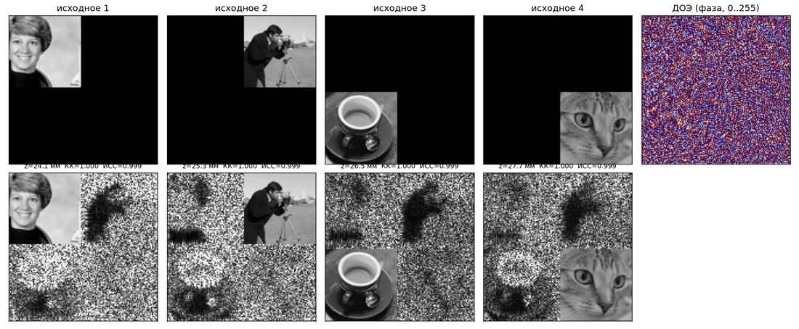

# Нейросетевой синтез фазовых ДОЭ

Нейросеть получает комплект из 4 изображений 128×128 и синтезирует **один фазовый дифракционный оптический
элемент (ДОЭ)** 128×128. При восстановлении методом дифракции Френеля (с одним преобразованием Фурье)
на расстояниях **24,1 / 25,3 / 26,5 / 27,7 мм** в каждой плоскости фокусируется своё изображение.
Длина волны 532 нм, пиксел ПВМС 10 мкм.

Ключевая идея: сеть **обучается через физику**. Точная модель дифракции Френеля встроена и в саму сеть,
и в функцию потерь, поэтому готовые «правильные» ДОЭ для обучения не нужны. Архитектура — развёрнутая
(unrolled) сеть: 12 блоков «физика → свёрточная сеть → поправка фазы», то есть выученный итеративный
алгоритм. После сети выполняется короткая градиентная доводка и доводка уже 8-битного ДОЭ.

**Итог на 8 независимых тестовых комплектах** (режим `best`, CPU): SSIM **0,9234** при нормировке по всему кадру и 0,9287 при подборе яркости по области, Pearson **0,9928**, ~57 с на комплект на CPU. Только нейросеть (`fast`): Pearson 0,9564, 0,5 с на комплект.

---

## 1. Запуск в Docker

Нужен только Docker. Все библиотеки и обученные веса уже внутри образа.

### Сборка
```bash
docker build -t doe-nn .
```

### Запуск на своих комплектах
Положите комплекты в папку, например `input/`:
```
input/
  set01/  1.png 2.png 3.png 4.png
  set02/  1.png 2.png 3.png 4.png
  ...
```
Linux / macOS:
```bash
docker run --rm -v "$(pwd)/input:/data/input" -v "$(pwd)/output:/data/output" doe-nn --mode fast
```
Windows (PowerShell):
```powershell
docker run --rm -v "${PWD}\input:/data/input" -v "${PWD}\output:/data/output" doe-nn --mode fast
```
Без подключённой папки контейнер прогонит встроенные примеры (`examples/`):
```bash
docker run --rm doe-nn --mode fast
```

### Что получается в `output/`
| файл | что это |
|---|---|
| `<комплект>/doe.png` | **фазовый ДОЭ: PNG, 128×128, 8 бит, grayscale**; 0 = −π, 255 = +π |
| `<комплект>/rec_1.png … rec_4.png` | восстановленные изображения (модуль поля), 128×128, 8 бит; яркость — максимум всего кадра → 255 |
| `<комплект>/metrics.csv`, `metrics.json` | SSIM и Pearson по информативной области каждого изображения |
| `<комплект>/overview.png` | исходные, восстановленные и ДОЭ на одной картинке |
| `summary.csv` | SSIM и Pearson по комплектам и среднее по всем комплектам, время на комплект |
| `timing.json` | время загрузки модели и синтеза каждого комплекта |

### Входные данные
* Комплект — папка с 4 файлами `.png` (128×128, 8 бит, grayscale). Файлы сортируются по имени
  «по-человечески» (`1.png, 2.png, …`): **изображение k восстанавливается на расстоянии k**.
* Можно передать папку с подпапками-комплектами или одну папку ровно с 4 файлами.
* Как в задании, информативная часть изображения k (62×62) лежит в своём углу чёрного кадра:
  1 — `[0:62, 0:62]`, 2 — `[0:62, 66:128]`, 3 — `[66:128, 0:62]`, 4 — `[66:128, 66:128]`
  (в задании записано `[0:61]`, `[66:127]` — включительно это те же 62 пиксела).

### Режимы (скорость / качество)
```bash
docker run --rm -v ... doe-nn --input /data/input --output /data/output --mode best
```
| `--mode` | что делает |
|---|---|
| `fast` | только нейросеть, один проход |
| `balanced` | нейросеть + 800 шагов устойчивой доводки + доводка 8-битного ДОЭ |
| `best` (по умолчанию) | нейросеть + 2000 шагов устойчивой доводки + доводка 8-битного ДОЭ |
| `max` | то же, 4000 шагов (немного точнее, вдвое дольше) |
| `best_roi` | 1000 шагов без устойчивости: максимум SSIM, если яркость восстановления подбирается по информативной области, но плохо при нормировке по кадру |

«Устойчивая» доводка оптимизирует ДОЭ сразу под два способа перевести модуль поля в 8 бит — с подбором яркости
по информативной области и с нормировкой на максимум всего кадра (раздел 7). Поэтому результат почти не зависит
от того, как именно проверяющий нормирует восстановленные изображения.

Другие параметры: `--device cpu|cuda`, `--threads N`, `--refine N` (своё число шагов), `--no_extra`
(сохранять только `doe.png`).

### С видеокартой NVIDIA
```bash
docker build -f Dockerfile.gpu -t doe-nn-gpu .
docker run --rm --gpus all -v "$(pwd)/input:/data/input" -v "$(pwd)/output:/data/output" doe-nn-gpu
```

### Самопроверка внутри контейнера
```bash
docker run --rm --entrypoint python doe-nn selfcheck.py
```
19 автоматических проверок: физическая модель против полной формулы, кодирование фазы, SSIM против
scikit-image, Pearson против numpy, модели, формат выходных файлов.

## 2. Запуск без Docker
```bash
pip install -r requirements.txt
python run.py --input input --output output --mode best
```

## 3. Результаты на примерах

В `examples/` — 8 независимых комплектов разных типов объектов: фото, текстуры, текст, геометрические фигуры,
бинарные изображения, научные снимки, смешанные, плавные градиенты. Источник — стандартные изображения
библиотеки scikit-image и синтетические фигуры (`scripts/make_example_kits.py`). **В обучении они не участвовали.**



Время — CPU AMD Ryzen 7 7840HS (8 ядер) внутри Docker-контейнера; модель загружается один раз на все комплекты (~1 с). «Кадр» — восстановление нормировано на максимум всего кадра → 255; «область» — яркость подобрана по информативной области. На GPU время в разы меньше.

**Режим `best` по комплектам**

| комплект | тип | SSIM (кадр) | SSIM (область) | SSIM skimage 7×7 (кадр) | Pearson | время |
|---|---|---|---|---|---|---|
| kit01_photos | фото | **0,9851** | 0,9894 | 0,9711 | 0,9944 | 41 с |
| kit02_textures | текстуры | **0,9998** | 0,9998 | 0,9998 | 0,9998 | 42 с |
| kit03_text | текст | **0,9910** | 0,9902 | 0,9704 | 0,9951 | 56 с |
| kit04_shapes | фигуры | **0,6192** | 0,6316 | 0,5446 | 0,9803 | 45 с |
| kit05_binary | бинарные | **0,8163** | 0,8352 | 0,7932 | 0,9817 | 49 с |
| kit06_science | научные снимки | **0,9942** | 0,9939 | 0,9910 | 0,9948 | 117 с |
| kit07_mixed | смешанные | **0,9984** | 0,9984 | 0,9978 | 0,9995 | 59 с |
| kit08_smooth | градиенты | **0,9830** | 0,9909 | 0,9714 | 0,9972 | 43 с |
| **среднее** | | **0,9234** | 0,9287 | 0,9049 | 0,9928 | 57 с |

**Все режимы (среднее по 8 комплектам)**

| режим | SSIM (кадр) | SSIM (область) | Pearson | время на комплект |
|---|---|---|---|---|
| `fast` | 0,5649 | 0,7699 | 0,9564 | 0,5 с |
| `balanced` | 0,9049 | 0,9148 | 0,9900 | 17,2 с |
| **`best`** | 0,9234 | 0,9287 | 0,9928 | 56,6 с |
| `best_roi` | 0,6357 | 0,9497 | 0,9958 | 22,8 с |

* На 6 комплектах из 8 (фото, текстуры, текст, научные, смешанные, градиенты) режим `best` даёт SSIM 0,9919 при нормировке по кадру и 0,9938 по области — почти одинаково.
* `best_roi` (прежний вариант без устойчивости) выигрывает при подборе яркости по области (0,9497), но при нормировке по кадру падает до 0,6357. Поэтому по умолчанию — устойчивый `best`.
* Ниже всего — фигуры (0,6192) и бинарные изображения (0,8163) на чёрном фоне: на идеально чёрном участке SSIM близок к 1, только если там почти нет света (шум меньше 2–3 уровней из 255), а фазовый ДОЭ не может «выключить» свет, только перераспределить. Pearson на них при этом 0,98.

### Сравнение с классическими методами

**kit01_photos** (фото), CPU в Docker:

* Один проход сети (448 мс, SSIM 0,8557) по качеству равен **150 итерациям Герчберга–Сэкстона** (894 мс) и **50 итерациям Adam** (580 мс).
* Время до заданного SSIM:

| метод | ИСС>=0.80 | ИСС>=0.90 | ИСС>=0.95 | ИСС>=0.98 |
|---|---|---|---|---|
| GS | 0.762 с (100 ит.) | 1.011 с (200 ит.) | 2.805 с (500 ит.) | не достигнут |
| Adam (случайный старт) | 0.580 с (50 ит.) | 1.561 с (75 ит.) | 1.561 с (75 ит.) | 2.328 с (150 ит.) |
| НС (один проход) | 0.448 с (0 ит.) | не достигнут | не достигнут | не достигнут |
| НС + доводка Adam | 0.448 с (0 ит.) | 0.535 с (3 ит.) | 0.709 с (15 ит.) | 1.260 с (30 ит.) |

**kit07_mixed** (смешанные), CPU в Docker:

* Один проход сети (356 мс, SSIM 0,8868) по качеству равен **150 итерациям Герчберга–Сэкстона** (462 мс) и **50 итерациям Adam** (698 мс).
* Время до заданного SSIM:

| метод | ИСС>=0.80 | ИСС>=0.90 | ИСС>=0.95 | ИСС>=0.98 |
|---|---|---|---|---|
| GS | 0.376 с (100 ит.) | 0.551 с (200 ит.) | 0.722 с (300 ит.) | 1.075 с (500 ит.) |
| Adam (случайный старт) | 0.698 с (50 ит.) | 1.009 с (75 ит.) | 1.009 с (75 ит.) | 1.247 с (100 ит.) |
| НС (один проход) | 0.356 с (0 ит.) | не достигнут | не достигнут | не достигнут |
| НС + доводка Adam | 0.356 с (0 ит.) | 0.367 с (1 ит.) | 0.498 с (7 ит.) | 0.630 с (20 ит.) |

Повторить: `python benchmark.py --images examples/kit01_photos`.

## 4. Как это работает

**Физическая модель** (`doe/physics.py`) — формула из условия:

K(x,y) = e^{jkz}/(jλz) · e^{jπ(x²+y²)/(λz)} · FFT{ H(u,v) · e^{jπ(u²+v²)/(λz)} },  H = e^{jφ}

* Множитель перед FFT и выходная квадратичная фаза не меняют |K|. Поэтому при обучении считается
  |FFT{H·Q_z}| (быстро), а итоговое восстановление (`fresnel_numpy`) реализует формулу полностью;
  расхождение двух реализаций ~1e-7.
* Шаг пиксела в плоскости восстановления λz/(NΔx) = 10,02…11,51 мкм. Условие дискретизации
  квадратичной фазы λz/(NΔx²) ≥ 1 выполнено во всех плоскостях (1,002…1,151).
* Используется `fftshift`: оптическая ось — в центре кадра (пиксел 64,64), ровно в зазоре между
  четырьмя областями изображений, куда в реальной установке попадает нулевой порядок.
* Восстановление и метрики всегда считаются **из сохранённого 8-битного `doe.png`**, то есть с учётом
  квантования фазы на 256 уровней.

**Нейросеть** (`doe/model.py: UnrolledDOENet`, 32 млн параметров):
1. *U-Net A* по 4 изображениям предсказывает фазу поля в каждой плоскости изображения; поля точно
   (необучаемо) пересчитываются обратно к ДОЭ и складываются → первое приближение φ₀.
2. 12 блоков, у каждого свои веса. Блок: прямой Френель → 4 плоскости; «шаг Герчберга–Сэкстона»
   (модуль в информативной области заменяется на цель, поле возвращается к ДОЭ); невязка
   (|K| − цель) тоже возвращается к ДОЭ; маленькая U-Net по этим подсказкам выдаёт поправку Δ;
   φ ← φ + α·(шаг GS) + π·tanh(Δ).
3. Необученный блок (Δ = 0, α = 1) — ровно одна итерация GS, поэтому сеть не может быть хуже классики,
   а обучение делает каждый шаг «умнее».

**Обучение** (`train.py`, `notebooks/train_kaggle.ipynb`):
* функция потерь — те же метрики, что у жюри: `10·MSE + (1 − Pearson) + (1 − SSIM)` в информативных
  областях, после аналитического подбора яркости (масштаб поля физически произволен);
* глубокий контроль (ошибка после каждого блока), сглаженные веса (EMA 0,999), AdamW, косинусное расписание,
  смешанная точность, 2 GPU;
* данные — Tiny-ImageNet (см. раздел 5), из которых на лету собираются случайные четвёрки 62×62
  в раскладке задания; аугментации: отражения, повороты, гамма, контраст, уровень чёрного;
* лучшая модель выбирается по отложенной части Tiny-ImageNet (2%, сеть её не видит).

**Доводка** (`doe/classic.py`): ответ сети уточняется градиентным спуском (Adam) по той же функции потерь —
10 шагов плавного разгона, постоянный шаг, затухание на последних 30%. Затем **дискретная доводка
8-битного ДОЭ**: по градиенту выбираются пикселы, где сдвиг на ±1 уровень фазы обещает выигрыш,
и шаг принимается, только если ошибка реально уменьшилась. Это убирает основную потерю от квантования фазы.

**Устойчивость к нормировке.** К ошибке доводки добавлено слагаемое с весом 0,5 — та же ошибка, но для
восстановления, нормированного на максимум всего кадра. Без него ДОЭ «сбрасывает» лишний свет за пределы
информативных областей, и при такой нормировке картинки становятся тусклыми (SSIM на примерах падал с 0,95
до 0,64 при неизменном Pearson). С ним свет вне областей держится не ярче нужного уровня. Вес и число шагов
подобраны на примерах обучающего набора (`docs/tuning.md`, раздел 5). Обучение сети это не затрагивает.

## 5. Данные для обучения

* **Tiny-ImageNet**: https://huggingface.co/datasets/zh-plus/tiny-imagenet — части `train` (100 000) и
  `valid` (10 000), всего 110 000 фото 64×64, переведены в оттенки серого. Скачиваются автоматически
  (`train.py --data auto`).
* `dataset/DATASET.md` — подробное описание обработки и разбиения, `dataset/samples/` — 50 примеров
  обучающих входов сети в формате задания.
* Полный банк картинок в том виде, в каком его видела сеть, создаётся командой
  `python export_dataset.py --data auto --out dataset --full` (`dataset/bank_gray64.npz`, ~300 МБ).

## 6. Обученные веса и повторное обучение

* `weights/doe_unrolled_v2.pt` — веса (EMA), сохранены в float16 (65 МБ), при загрузке переводятся в float32.
* Обучение: Kaggle, 2× NVIDIA T4, 11 903 итерации, 9,6 ч, батч 16. Итог на отложенной выборке
  (только сеть, без доводки): **Pearson 0,987, SSIM 0,928**. Лог: `training/log.csv`, параметры: `training/args.json`.
* Повторить: загрузите `notebooks/train_kaggle.ipynb` на Kaggle (GPU T4 x2, Internet On) и нажмите
  *Save & Run All*. Или локально с GPU:
  ```bash
  pip install -r requirements-train.txt
  python train.py --data auto --time_budget_h 10.5 --amp --out runs/main
  python scripts/export_weights.py runs/main/best.pt weights/doe_unrolled_v2.pt
  ```

## 7. Метрики

* **Pearson** — коэффициент корреляции по информативной области.
* **SSIM** — основной столбец: гауссово окно 11×11, σ = 1,5 (совпадает со `skimage.metrics.structural_similarity`
  с `gaussian_weights=True` до 1e-9). В `metrics.csv` и `summary.csv` также: `ssim_skimage_default`
  (scikit-image по умолчанию, окно 7×7), `ssim_global` (одно окно на всю область, формула из презентации),
  `ssim_matlab` (края как в MATLAB `ssim()`).
* **Нормировка.** Чтобы перевести модуль поля в 8 бит, его надо отнормировать. Основной столбец `ssim`
  в режимах `fast`/`balanced`/`best`/`max` — при нормировке на максимум всего кадра 128×128 → 255
  (стандартно и без знания цели; так же сохранены `rec_k.png`). Дополнительно в `summary.csv`:
  `ssim_frame_norm` (то же) и `ssim_roi_fit` (яркость подобрана по информативной области методом наименьших
  квадратов, как подбор экспозиции камеры). В режиме `best_roi` основной столбец — при подборе по области.
  Pearson от нормировки не зависит.

## 8. Структура
```
run.py                 точка входа: все комплекты -> doe.png (+ восстановления, метрики, время)
synthesize.py          синтез для одного комплекта (методы nn, nn+refine, best, adam, gs)
benchmark.py           сравнение скорости/качества с классическими методами (GS, Adam)
selfcheck.py           самопроверка
train.py               обучение
export_dataset.py      описание и экспорт обучающего набора
make_notebook.py       собирает notebooks/train_kaggle.ipynb из исходников
doe/physics.py         дифракция Френеля (torch и полная numpy), кодирование фазы, области
doe/model.py           UnrolledDOENet (основная) и DOENet (простая, для сравнения)
doe/metrics.py         SSIM, Pearson, функция потерь
doe/data.py            загрузка данных и генерация обучающих четвёрок
doe/classic.py         Герчберг–Сэкстон, Adam, дискретная доводка 8-битного ДОЭ
doe/evaluate.py        ДОЭ.png -> восстановление -> png + метрики
weights/               обученные веса
examples/              8 примеров комплектов
dataset/               описание обучающего набора и примеры
training/              лог и параметры обучения
notebooks/             ноутбук обучения (Kaggle / Colab)
scripts/               генерация примеров, экспорт весов
Dockerfile, Dockerfile.gpu, requirements.txt, requirements-train.txt
```
